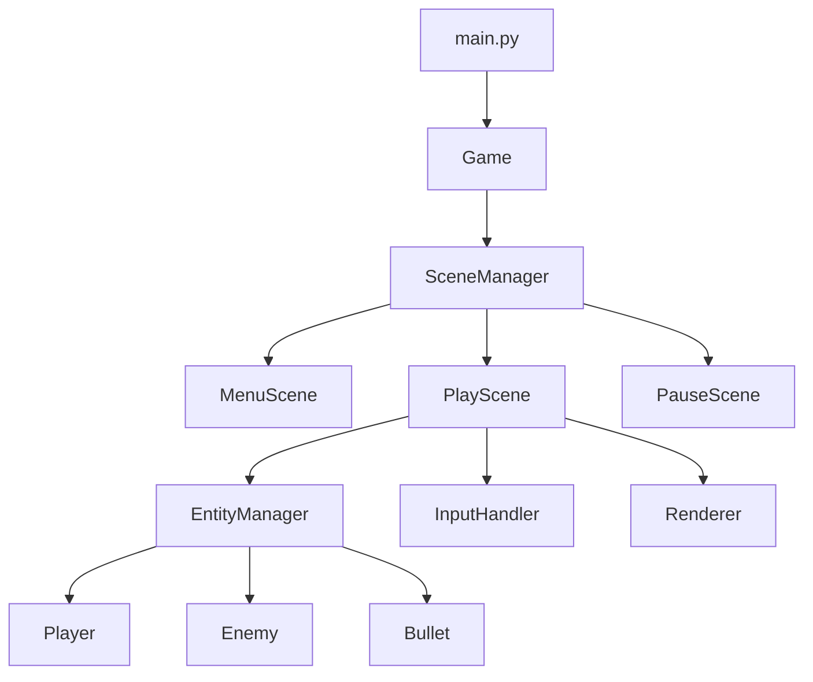

# Архитектура игры «HSE's sessions week»

## 1. Общая идея

Игра построена на **сценовом подходе**. Есть главный класс `Game`, который:
1. Инициализирует pygame.
2. Создаёт окно.
3. Запускает игровой цикл.
4. Делегирует логику текущей сцене.

Сцена — это отдельное состояние игры: меню, сама игра, пауза, экран проигрыша.
В каждый момент активна **ровно одна сцена**.

## 2. Схема модулей




## 3. Модули и их ответственность

| Модуль | Файл | Что делает |
|---|---|---|
| `Game` | `src/core/game.py` | Главный цикл, окно, FPS |
| `SceneManager` | `src/core/scene_manager.py` | Переключение сцен |
| `PlayScene` | `src/scenes/play.py` | Логика игрового уровня |
| `MenuScene` | `src/scenes/menu.py` | Главное меню |
| `EntityManager` | `src/systems/entities.py` | Хранит и обновляет всех существ |
| `InputHandler` | `src/systems/input.py` | Читает клавиатуру |
| `Renderer` | `src/systems/renderer.py` | Рисует спрайты и камеру |
| `Player` | `src/entities/player.py` | Игрок: движение, стрельба |
| `Enemy` | `src/entities/enemy.py` | Базовый враг |

## 4. Игровой цикл

Каждый кадр (обычно 60 раз в секунду) происходит следующее:

```
1. Обработать события pygame (закрытие окна, нажатия клавиш)
2. Обновить логику текущей сцены (update)
3. Отрисовать текущую сцену (draw)
4. Ограничить FPS до 60
```

Код:
```python
def run(self):
    while self.running:
        dt = self.clock.tick(60) / 1000  # время кадра в секундах
        self.scene_manager.handle_events()
        self.scene_manager.update(dt)
        self.scene_manager.draw(self.screen)
        pygame.display.flip()
```

## 5. Как устроены игровые объекты

Все сущности наследуются от базового класса `Entity`:

```python
class Entity:
    def __init__(self, pos):
        self.pos = pygame.Vector2(pos)
        self.velocity = pygame.Vector2(0, 0)

    def update(self, dt):
        pass

    def draw(self, screen, camera):
        pass
```

Конкретные классы (`Player`, `Enemy`, `Bullet`) переопределяют `update` и `draw`.

## 6. Ввод

Состояние клавиш хранится в `InputHandler`. Сцены не читают pygame напрямую —
они спрашивают у хендлера: «нажата ли клавиша W?». Это упрощает тесты и смену управления.

## 7. Рендеринг

Есть камера, которая смещает координаты мира. Порядок отрисовки:
1. Фон
2. Тайлы уровня
3. Сущности (сортируются по Y — чтобы персонаж «заходил» за объекты)
4. UI (HUD, здоровье)

## 8. Физика и коллизии

Простые AABB-коллизии (прямоугольники). Игрок и враги проверяются
против тайлов уровня. 

## 9. Ресурсы

Все картинки и звуки загружаются **один раз** при старте в `AssetLoader`
и лежат в словаре. Это чтобы не читать диск каждый кадр.

## 10. Конфигурация

Все настройки (размер окна, скорость игрока, цвета) — в `src/settings.py`.

## 11. Известные ограничения

- [ ] Нет системы сохранений.
- [ ] Нет поддержки геймпада.

